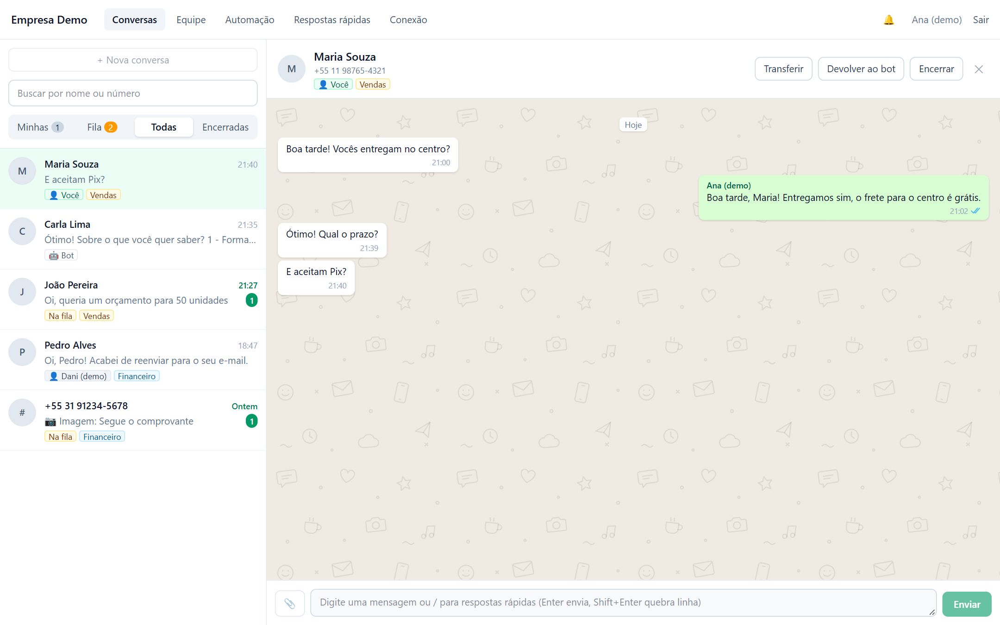
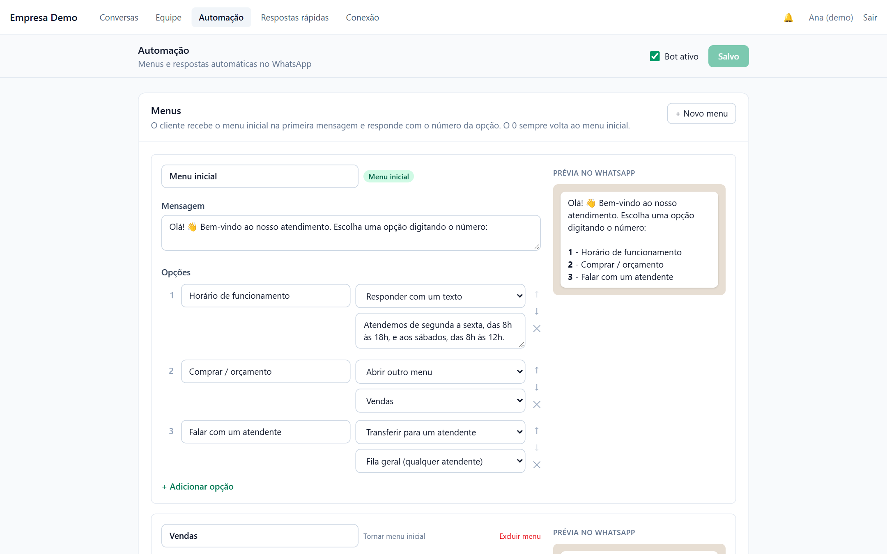
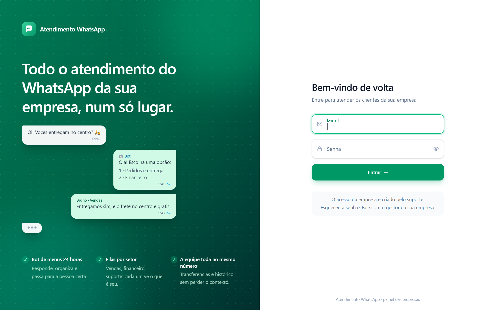
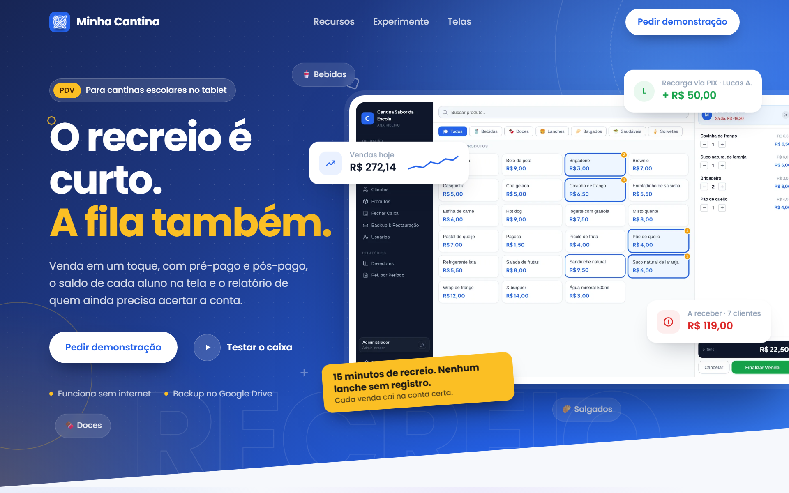
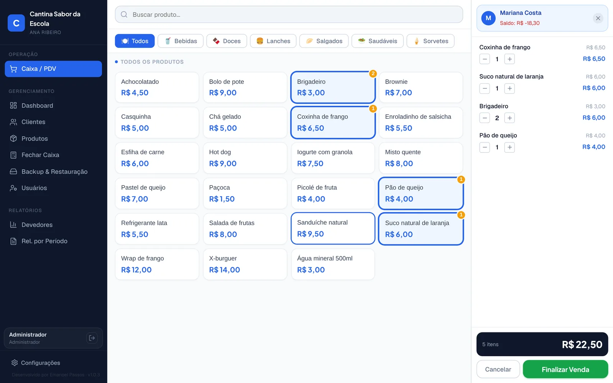
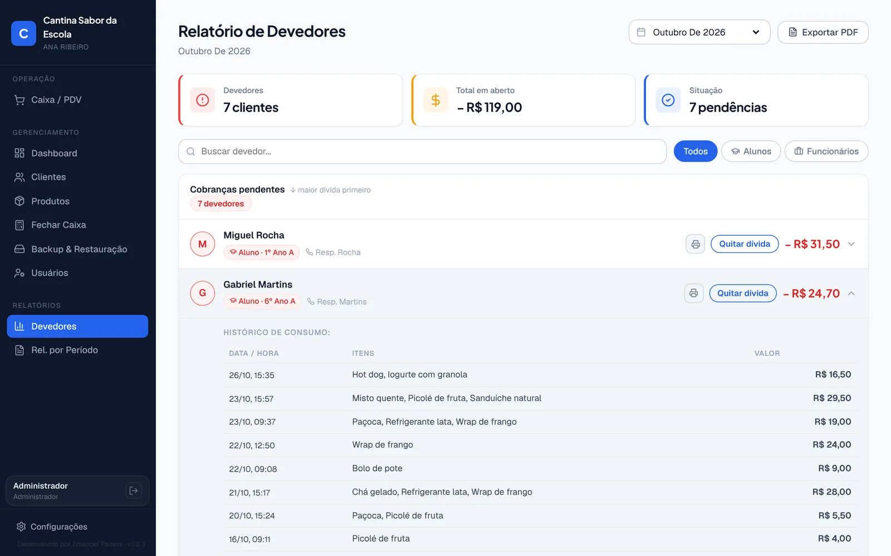

<h1 align="center">Olá, eu sou o Emanoel 👋</h1>

  <b>Desenvolvedor full-stack em Cuiabá/MT</b> 
  Crio sistemas que resolvem problemas reais de pequenas empresas e escolas: 
  SaaS de atendimento no WhatsApp, PDV offline para cantinas e agendamento escolar.

  
  
  

---

## 🚀 Projetos em destaque

### 💬 WhatsApp SaaS: atendimento e automação para empresas
Plataforma **multiempresa** para equipes atenderem clientes pelo WhatsApp num painel compartilhado.
- Filas por setor, transferência entre atendentes e conversas "minhas / fila / todas"
- **Chatbot** com menus e palavras-chave, que passa a conversa para um humano quando precisa
- Envio e recebimento de mídia (fotos, áudios, documentos), confirmação de leitura e busca
- Perfis de dono, gestor e atendente, com autenticação JWT e painel de superadmin

`TypeScript` `Node.js` `Fastify` `Prisma` `PostgreSQL` `Redis` `Next.js` `Tailwind` `Docker`

  

<table>
  <tr>
    <td width="50%"> Chatbot com menus e prévia no WhatsApp</td>
    <td width="50%"> Tela de acesso das empresas</td>
  </tr>
</table>

---

### 🍽️ Minha Cantina: PDV para cantina escolar (Android + Windows)
Sistema de ponto de venda para o dia a dia de cantinas escolares. Roda **100% offline** no tablet.
- Venda por toque, com pagamento em dinheiro, PIX, cartão ou **saldo pré-pago do aluno**
- Controle de devedores, com extrato em PDF compartilhável pelo WhatsApp
- Relatórios por período, fechamento de caixa e backup no **Google Drive**
- **Atualização automática** via GitHub Releases, com um plugin nativo em Java que instala o APK

`React` `Vite` `Capacitor` `SQLite` `Zustand` `Electron` `Java`

📩 Implantação feita por mim, sob contratação. Fale comigo pelo [LinkedIn](https://www.linkedin.com/in/emanoelpassos/) ou por [e-mail](mailto:passos.patrick@gmail.com).

  

<table>
  <tr>
    <td width="50%"> Caixa / PDV com saldo do aluno</td>
    <td width="50%"> Relatório de devedores com histórico de consumo</td>
  </tr>
</table>

---

### 📅 Agenda Professor: reuniões de pais e professores
Sistema web **em produção** num colégio. Os pais agendam, remarcam ou cancelam a reunião pelo celular informando só o CPF, sem criar conta.
- Painel da coordenação com importação da planilha da secretaria (.xlsx) e exportação para PDF
- Feito com atenção à **LGPD**: dados mínimos nas rotas públicas, limite de tentativas, Turnstile anti-robô e senhas com PBKDF2
- Roda **inteiro no plano gratuito da Cloudflare**, sem servidor próprio

`React` `TypeScript` `Tailwind` `shadcn/ui` `TanStack Query` `Hono` `Cloudflare D1` `Cloudflare Pages`

🔗 [agendaprofessor.pages.dev](https://agendaprofessor.pages.dev)

  

---

## 🛠️ Tecnologias

**Linguagens** 

**Front-end e mobile** 

**Back-end e dados** 

**Infra e DevOps** 

---

  💡 Aberto a projetos freelance e oportunidades. Vamos conversar!

